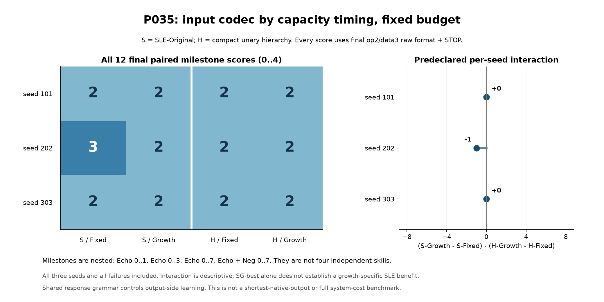
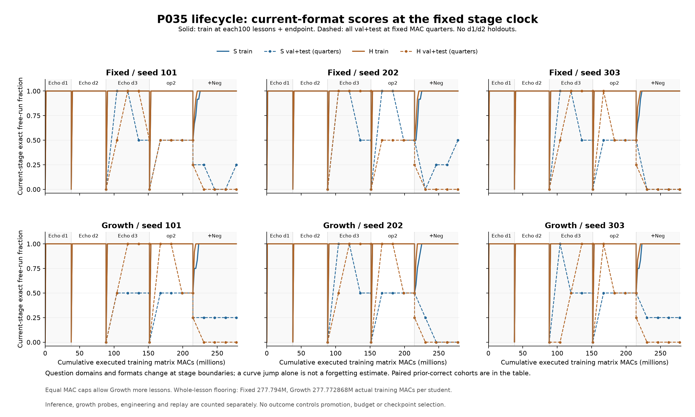

# P035：已教題全對，未教題仍弱；本批未見成長收益

事前規格日期2026-11-12；正式實測為台北時間2026-11-13。使用者指定「繼續實驗，記得看git」，沿用agent分工授權。Git查核發現PR #8更新至`4e2ded91166a4fd9348dccf8fc71ddf01e991645`，新增Pro「小網路與成長假說審查」第6節。U為使用者SLE／持續成長構想；A為Pro候選及Codex凍結的具體條件；本輪T為Codex與受指派agent真正實作、執行、重播及獨立驗收。P034在PR #9已完成，沒有延長失敗attention配置或重跑其控制。

12名新學生都學會最後12道已教組合，合計144/144；固定未教運算元的val+test為5/48。主要里程分數僅S-F/202達3，其餘11名均2，沒有人達4。三個配對interaction為0、−1、0，未顯示這批條件下SLE特有的成長收益。

## 比較實際控制了什麼

S=SLE-Original，H=Flat-Hierarchical-unary-v1；各搭配固定最終容量F／共同階段成長G，以及seed101/202/303。每seed四條為配對條件，不把12條稱為12個獨立抽樣。

S題目沿P031一層原碼`01 | opID(n_op) | 0 | value(n_data) | 0`；H為緊湊階層一元子集`1 | opID(n_op) | value(n_data)`，1為math分支、0保留control分支，本地ID／highwater與資料低位不重配。這不是任意遞迴文法的完整實作。兩側同等使用外部profile做合法轉換，學生只見raw01題目接答案prefix，沒有AST、profile、詞界、資料位對齊或答案長度特徵。

**答案兩側共用n_data資訊位＋尾0＋模型STOP。** 這控制輸出側學習，使P035測輸入codec×容量時序；不代表H的最短native-output或全系統編碼成本比較。H的題目比S短3bits，但兩側同階取得共同最大L/H、同參數與dense MAC口徑，不讓較長格式自動取得更多容量。

學生重用P030的float32 two-channel onehot／tanh MLP與Adam。原始初始化、.003學習率、.9/.999動量、1e-8 epsilon、global norm clip1及birth age均不改。reference檔與main原版的Model AST相同，檔案差異只是封存路徑整合，來源與SHA見lineage及source-freeze。

## 固定外定課程，失敗也保留

|階段|教學／表示|G的共同L/H|G參數|每學生training dense MAC上限|
|---|---|---|---:|---:|
|0|Echo data1/op1|8/64|1283|37,881,000|
|1|Echo data2/op1|10/66|1587|50,508,000|
|2|Echo data3/op1|12/68|1907|63,135,000|
|3|Echo data3/op2，只改表示|13/69|2073|63,135,000|
|4|同形狀新增Neg，兩op均衡|13/69|2073|63,135,000|

F從相同小學生在t0按同序列grow到13/69；G在各階入口才grow。兩codec同策略／seed的初始完整state、同ordinal語義教材與target完全配對。擴張保留舊p/m/v/birth與t，之後全網可訓練；合法0的onehot不是padding零向量。同raw函數保持與改格式適應分開驗收。

data1/data2全值都教，沒有holdout；data3 train為0/1/2/3/5/7，val4、test6。最初0與1均有教材。課程是整個(op,value) block的固定seed置換；各階按MAC上限走完，不因通過／失敗或holdout成績決定下一階。全部12名走完五階，沒有只選成功升階者。

**4/6沒有作訓練運算元，卻在訓練答案中出現。** 最後Neg(1)=6、Neg(3)=4，每學生的教師回覆各出現250次；不能稱數值4/6在所有角色都未見。逐值、op-value、位寬與輸入／答案角色帳均保留。整個1..3bit域早已查看，這是固定域機制篩查，不是研究新盲測；V1/V2仍須獨立規格。

## 主要里程與配對結果

主分數是在最後當前op2/data3格式，整串自由生成連STOP都正確的最高連續累積里程：1=Echo0/1，2=Echo0..3，3=Echo0..7，4=Echo及Neg各0..7。四者是巢狀條件；op位寬事件不重複算新技能。

|seed|S-F|S-G|H-F|H-G|interaction=(SG−SF)−(HG−HF)|
|---|---:|---:|---:|---:|---:|
|101|2|2|2|2|0|
|202|3|2|2|2|−1|
|303|2|2|2|2|0|

|條件（三seed）|已教／36|val／6|test／6|heldout／12|Echo全值／24|Neg全值／24|
|---|---:|---:|---:|---:|---:|---:|
|S-F|36|1|2|3|21|18|
|S-G|36|0|2|2|20|18|
|H-F|36|0|0|0|18|18|
|H-G|36|0|0|0|18|18|

全部heldout成功都來自Echo，Neg為0/24。S比H多5筆heldout正解是本批觀測，仍限於這個學生、共用答案文法與已查看的微小域；沒有跨seed一致的SLE成長額外收益。S-G單格表現或四組平均不能取代配對interaction，也不報三seed的臆造顯著性。沒有人在最後同時掌握全部16種組合，為0/12。

已教題144/144，表示本次失敗主要不是最後已教組合擬合不足。heldout首錯位bit0/1/2為31/11/1，另5題全對；31題第一bit已錯，尚沒有答案prefix，不能把所有失敗全歸先前答案級聯。heldout資訊位free-run正確17/31/10（各／48），正確前綴下為17/29/41；後位條件明顯不同，但尚未隔離內部因果。確定性自回歸的整串TF全對與自由生成全對本就等價，不當額外機制證據。

最後STOP位置與尾0各192/192正確，答案資訊位仍可錯；固定長度停止不能算已理解Echo／Neg通則。

## 跨階恢復與遺忘不能混算

data1→data2與data2→data3，原先正確的舊語義在新格式入口的整串分數皆0；各階末原有24/24及48/48全部恢復。這裡同時更動資料字串及答案寬度，不能直接稱數學語義全部消失。

只把op1改成op2時，之前當階Echo共有89/96全對，改碼入口0/96，該階末84/96。相同舊raw的grow驗收仍保持logits（最大差0），所以保函數不等於改碼後自動適應。原本已對的89筆有5筆在該階末未保留；之前已錯的7筆另列，不冒稱遺忘。11名曾在固定quarter觀測中完整恢復其原先正確cohort，仍有人其後退步；只在0/25/50/75/100%保存全truth，不能發明精確恢復題次。

全部階段的same-raw logit最大浮點差為1.90735e-6，發生在data2→data3，符合原P030的2e-6工程門檻；op位寬事件本身為0。舊參數／optimizer陣列逐元素拷貝精確，不把近似logit保持寫成全域bitwise相同。

最後加Neg時，raw形狀與模型形狀不改，入口原Echo84/96正確。結尾原先84筆保住76、失去8，另外新答對1筆，故Echo總分77/96。這個配對cohort區分淨分數與實際失去／新增；不同stage總曲線的跳動本身不是遺忘量。每階舊重疊p/m/v/birth漂移與完整功能分數一起保存，沒有用權重變動大小替代能力判斷。

## 成本與工程證據

參數H(2L+4)+3；forward H(2L+3)、backward H(2L+6)，每target訓練H(4L+9) dense MAC。F每學生15000題、66000target、277,794,000MAC；G為17973題、76337target、277,772,868MAC，整題邊界剩21,132、不carry。兩側同策略的S/H成本／題序完全相同；G較多曝光是此容量時序政策的一部分，不能單歸於參數移植機制。

本輪197,838題／854,022次新target更新，主要訓練3,333,401,208MAC；完整重播另外同數，共1,708,044次更新／6,666,802,416訓練MAC。逐學生推論counter合計398,980,204，含被複製template的初始化計數，不是全系統唯一實體operation總數；工程、編解碼、證據雜湊與非線性成本另列。這裡的預算是training dense MAC，不是硬體總FLOPs或全系統成本上限。

最終每學生p/m/v/birth陣列41,460bytes，早階G最小25,660bytes；不是peak RAM或activation量。正式manifest於台北2026-11-13 00:00:09.710901保存，compact檔案最後寫入00:08:06.172933（檔案metadata，不是捏造的精確process退出時刻）。主學習／重播／證據流程476.33秒，不含事前課程與template準備，不當純kernel時間。Python3.12.14／NumPy2.3.5、單thread BLAS；Matplotlib只用於事後繪圖。

開跑前codec與runner經真工程驗收及獨立檢查，再封存9來源SHA。工程開發修正過Python3.12 loss加總1ulp及tuple／JSON list比對，屬driver驗收問題，未動學生、optimizer或正式科學結果。最終runner SHA `0428f5ce96acc3e60d28abcb23ba96585df5bdce3f80ebc6e269df9e2464fe69`；protocol `68dac62882e8983945beb9b705cca6c34817f605d7f97b711dff345310c988ec`。正式啟動只有一次，未改碼、改預算、加seed或重啟。

所有854,022個target的prefix、預測、loss、完整p/m/v/birth/t／RNG digest，曲線、snapshot、起終完整陣列皆以獨立target-loop重播精確一致。重播不是新學生。另一agent禁止step／lesson／loss_grad，唯讀核197,838題與854,022筆記錄、300份完整checkpoint，實際重算2280筆自由生成／TF／logits，並核跨階grow、來源、配對課程、曝光、MAC及主分數，沒有實質finding。

## Agent、NVIDIA與完成邊界

主代理讀Git／凍結規格、整合解讀與發布；兩個agent分別實作codec／交付工具、runner／唯一正式程序，第三agent做獨立工程及完整artifact稽核。完整紀錄留work，公開白名單保存state、truth、曲線、失敗例及SHA；大逐target trace留本機可由固定程式重生。

NVIDIA派工`P035-NVIDIA-REVIEW-001`真呼叫一次，免費Lightning、cost0、3207輸入／747輸出tokens、finish=stop。回覆是有效JSON，但捏造MAC／p值並混用端點方向，數字與統計主張經本機反例拒絕；一般等參數不等計算及interaction提醒另核。沒有提供可驗證的新compact codec反例，也沒有重試或把模型意見當PASS。公開副本移除機器私密raw API記錄欄位，帳號／quota／憑證不發布。

本輪完成一次凍結的輸入編碼×容量時序篩查。它保留小網路能學有限已教SLE任務的正面結果，未支持本批通用copy/flip或SLE特有成長收益，也不能否定其他架構、課程、編碼／成長排程及更大域。原生NN／VM主線、最短native輸出、V1/V2獨立分流、4/5bit、升階儀式、神經翻譯及新算符仍另立研究；沒有依本次成績繼續擴張或追加試驗。
