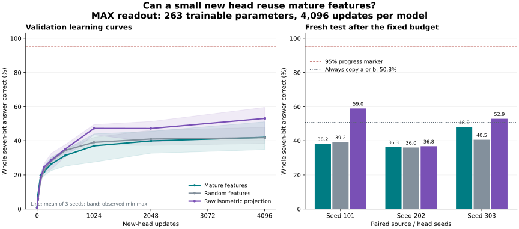

# Mature feature reuse: a bounded negative result

A new small MAX head did **not** benefit reliably from the mature receiver's hidden features in this fixed experiment. The raw information-preserving projection beats the mature features on final train, final test and validation learning-curve area in all three paired seeds. All nine heads fail the 95% progress marker, including on their training data.

The mature receiver itself still decodes every fresh test input correctly: 3,120/3,120 per seed. Its hidden state therefore retains operand information accessible to its original readout. This result does not show that learned information has disappeared or that no other head can reuse it.

## Actual comparison

Each condition uses the same 24→8→7 head (263 trainable parameters), paired initializations and minibatch streams, and 4,096 updates. Sources stay fixed solely to isolate feature transfer. This does not replace the broader growth hypothesis—which permits initial disturbance and recovery—with a permanent-freezing requirement.

| Features | Seed 101 test | Seed 202 test | Seed 303 test |
|---|---:|---:|---:|
| Mature receiver hidden | 38.21% | 36.31% | 48.04% |
| Random nonlinear hidden | 39.20% | 36.03% | 40.54% |
| Raw isometric projection | 58.97% | 36.76% | 52.88% |

Every answer requires all seven bits correct. Always copying either operand scores 50.769% on this test. Every Mature and Random run is below that baseline. Final training scores span 38.17–58.65%, so the failure already occurs during fitting; head capacity, optimization, budget and interface use have not been uniquely separated.

## Fresh data and task boundary

Train/validation/test contain 1,036/268/396 unordered operand groups, expanded to 8,240/2,096/3,120 raw frames. Both operand orders and all four opcodes remain in the same split. Neither ordering appears in any source/ancestor train, validation or test group. All nine training runs finish before fresh test features or predictions are computed.

The bounded domain retains the source restriction a+b<128; this is not all seven-bit pairs or unseen number vocabulary. Existing ADD/XOR/AND/OR codes are nuisance variation for a separately selected MAX readout. No opcode meaning is changed, no new formal MAX code is allocated, and no task router or complete SLE answer frame is learned.

The raw affine projection preserves all 18 varying input directions (rank18, condition number approximately1). All conditions use train-only mean24 plus one global RMS scalar. They have equal new-head capacity and active feature-bank shape, not equal full-system storage: the mature system retains its original450-parameter readout.

## Post hoc finding and next test

Of16,007 test model×variant errors,15,579 (97.326%) output neither operand. A follow-up could reuse the actual decoded words and train only a left/right selector, with a counted fixed copy path and a same-architecture learnability control. This is an unexecuted proposal. Success would initially support task decomposition and reuse of an existing readout; it would not establish SLE superiority.

Grouped all-variant successes and opcode consistency offer limited mature-versus-random signals, but do not replace the failed primary metrics. Full post hoc results and all failures are retained.

## Execution, cost and independent verification

One automated run:36,864 optimizer updates,4,718,592 presentations,81 checkpoints;17.361seconds including caching, evaluation and serialization. Training forward MAC1,170,210,816; feature computation98,820,864MAC; evaluation head67,459,968MAC; source-readout audit4,043,520MAC. Cached features occupy44,727,675bytes. Timing excludes preparation, independent auditing and delivery; inherited source training is not free.

Independent audit passed81checkpoints,99prediction files/272,016rows,27feature caches/121,104rows,9,360source-readout rows and144short verification-only Adam recurrences (16 per head). Features, logits, metrics, early parameters and optimizer state match exactly. The full36,864-step training was not replayed. Locked hashes, the completion barrier and temporal records agree.

See [full report](report_zh.md), [protocol](protocol.json), [source lock](source_lock.json), [post hoc analysis](posthoc_analysis.md), [preparation audit](preparation_audit.json), and [result audit](result_audit.json). Exact archive identity and packaged replay are in the delivery record added after archive creation.

## Provenance

Preregistered commit:4798c3a4dbd15d0b3c00b90581092536102a88c4. Source-lock commit:23e738f4491fa755d6152491cc5a78f82824e99d. Both precede experimental training. Data, seeds, budget and primary metrics were fixed before training; final train-fit scoring was added as a documented pretraining diagnostic.

Source:[PR130](https://github.com/Bigbearbo/Rasengan_Binary_Creator/pull/130), c35ff7d13ae427fc2ed6c5959665d121edd6bf50. Prior question:[PR131](https://github.com/Bigbearbo/Rasengan_Binary_Creator/pull/131),1d6353844368bcbb55553330f13c533a2bb227ef.

Related primary work:[Progressive Neural Networks](https://arxiv.org/abs/1606.04671) and [How transferable are features in deep neural networks?](https://arxiv.org/abs/1411.1792). These motivate the controls; their results are not this study's evidence.

NVIDIA:skipped_unavailable,0actual calls. Independent local method/results review was performed. No external teacher, new W execution, main-queue mutation, merge or deployment. The archive preserves weights, full predictions, caches, all errors and source provenance; public Git is the screened report/code/replay entry.
