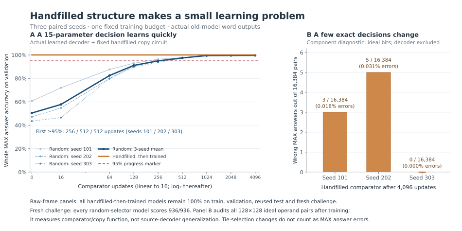

# Handfilled selection and copy over a learned SLE word decoder

Run: `pro_handfill_selector_20261118_v1`  
Status: completed and independently replayed. A final bookkeeping exception was recovered from saved outputs without retraining or new inference.

## Result

| New module | Updates per seed | Reused test, 3,120 frames | Fresh challenge, 936 frames | Ideal component errors / 16,384 pairs |
|---|---:|---|---|---|
| Exact handfilled comparator + copy | 0 | 100% in all three | 100% in all three | 0 / 0 / 0 |
| Random comparator + handfilled copy | 4,096 | 99.615% / 99.744% / 99.744% | 100% in all three | 69 / 26 / 52 |
| Exact handfilled comparator, then trained | 4,096 | 100% in all three | 100% in all three | 3 / 5 / 0 |

The random 15-parameter comparator first reaches validation95% at checkpoints256/512/512. The actual learned source decodes every one of43,176 source rows correctly. The new copy network always emits one of those actual decoded words. The fresh challenge contains117 independent unordered pair groups, not936 independent groups.

Continued training slightly changes an initially exact rule in two seeds, despite perfect sampled raw-frame panels. Three wrong component pairs remain inside the source sum-domain; five are outside. Tie-selection changes do not count as wrong MAX answers. This is same-task function drift, not a continual-learning or topology-change result.

Full interpretation and costs: [Chinese report](report_zh.md). Machine-readable compact results: [results_summary.json](results_summary.json).

PR132's small MAX head frequently generated an answer that was neither input. This follow-up reuses the source network's actual decoded words and explicitly constructs the selection/copy calculation as a sparse threshold network. It tests a complete handfilled decision, random initialization of the same small decision followed by training, and correct handfilled initialization followed by training on the same task.

All three conditions use the same frozen PR130 receiver (34→24→18, 1,290 parameters) and the same fixed copy network. The comparator has 14 weights and one bias. The copy network has 21 threshold units, 42 edge weights, 21 biases, and explicit sparse wiring. The full candidate retains 1,368 numeric model values; trained conditions update only 15. The handfilled comparator contains binary place values and the comparison rule; it is an engineered prior, not a rule learned from examples.

Six trained models (two initializations × seeds 101/202/303) receive exactly 4,096 Adam updates of batch128; three additional controls receive zero updates. Train/validation/old test and batch streams exactly reuse PR132. Its test results informed this design, so that test is a continuation benchmark. All117 previously unused unordered pairs provide a separately fixed challenge of936 frames. Neither test panel is evaluated before every model finishes its budget. The recorded95% level is a progress marker, not a condition to extend training.

The actual inference path is raw frame → learned source logits → thresholded operand words → comparator neuron → handfilled threshold copy gates → seven answer bits. Teacher operands are used for selector labels and scoring, never to repair source predictions. An ideal-bit exhaustive component audit is separately labeled and is not evidence for raw-frame decoding.

The fixed MAX readout is externally selected; original ADD/XOR/AND/OR opcode meanings are unchanged. There is no new formal MAX opcode, learned task router, variable-width claim, or complete serialized SLE answer. PR132 comparisons also change supervision, interface, parameters and copy priors; they cannot isolate encoding advantage. Source freezing is a causal control for this experiment, not a requirement that growing networks must never regress.

## Reproducible evidence

`protocol.json` fixes the experiment. `source_lock.json` hashes execution code, raw-bit data, copied sources, fixed gates and batch streams. `source_manifest.json` records source lineage. Complete predictions, checkpoints and failure records are delivered in the immutable archive; the delivery commit records its size/SHA256/CRC and replay entry. No formal Codex queue, other research branch or main is changed.

Preregistration commit: `40d5a0ec1033a20299b19fbe3a3db35be4bf119e`. Execution source-lock SHA256: `6622b5d38ba9cb35b05c98eadf544af68b2c5a1fe03679f05d84b1d47b96367d`.

The independent verifier imports no experiment modules:43,176 source rows,57 checkpoints,99 prediction files/475,896 rows,32,768 mux truth-table rows and96 early Adam verification recurrences pass. Hard outputs match exactly; maximum float difference is2.84e-14. The full24,576 experimental updates are not repeated during verification.

The original locked runner is preserved with its final Path-join typo: all training/inference outputs already existed when it failed. `finalize_existing.py` checked190 scientific-file hashes and rebuilt metadata only. The status is `completed_after_metadata_recovery`; the original error and pre-recovery metadata remain in the archive.8.137301 seconds is a saved UTC timestamp span, not the lost perf-counter timing. See [REPLAY.md](REPLAY.md) before replaying; do not rerun preparation/training over delivered results.

The full model retains1,368 numeric values and adds22 threshold units, with15 trainable values in learned arms. Compared with PR132's mature hidden-head configuration, retained values drop1,578→1,368, while per-query forward MAC increases1,064→1,304 because the original decoder output layer is now used. Explicit selector labels and handfilled copy priors are added, so this is not a pure encoding or equal-architecture comparison.

U: the user's growth, word communication and handfill/training direction. F: PR130/PR132 sources and the Fable W candidate profile. A: this comparator/copy experiment. T: actual execution receipts, added after execution. NVIDIA review is unavailable in this environment; external model calls0. Independent local review is recorded separately.
